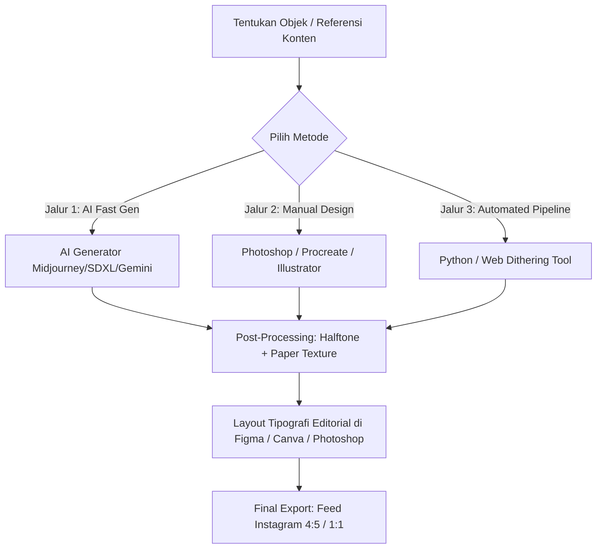

# Summary Plan: Replikasi Gaya Visual Ilustrasi DzikirQu
*(Halftone / Dithering + Risograph Print + Retro Paper Texture)*

Dokumen ini merangkum analisis mendalam dan panduan implementasi langkah-demi-langkah (workflow) untuk memproduksi konten visual dengan estetika retro-editorial seperti pada akun Instagram **DzikirQu**.

---

## 1. Analisis & Anatomi Gaya Visual

Gaya visual DzikirQu memadukan unsur seni grafika cetak klasik (*printmaking*) dengan sentuhan modern minimalis:

| Elemen Visual | Karakteristik Utama | Fungsi Estetika |
| :--- | :--- | :--- |
| **Shading / Bayangan** | Halftone dots (pola titik/dot screen) atau *Stochastic/Error-diffusion Dithering* | Menciptakan ilusi gradasi bayangan dengan jumlah warna terbatas seperti cetakan koran klasik. |
| **Warna & Palet** | *Limited Palette* (1–2 Spot Colors, misal: Deep Charcoal/Warm Ink Black, Sepia, Terracotta, Vintage Olive) | Meniru keterbatasan warna mesin Risograph atau mesin cetak stensil manual. |
| **Background / Kertas** | Tekstur kertas lawas (*kraft paper*, koran buram, *recycled watercolor paper*) bernada warm cream/ivory (`#F5EFEB` s/d `#EBE3D5`) | Memberi nuansa hangat, tenang, nostalgik, dan tidak menyilaukan mata (*paper feel*). |
| **Linework & Objek** | Ilustrasi semi-realis / siluet / woodcut engraving dengan garis halus atau batas bentuk yang terbentuk dari kepadatan titik (*dot density*). | Menekankan pesan kontemplatif, syahdu, dan elegan. |
| **Tipografi** | Serif modern atau Humanist Sans bergaya editorial buku (layout minimalis, whitespace luas). | Memberikan kesan kutipan buku/literatur yang berbobot dan rapi. |

---

## 2. Pilihan Jalur Produksi (Production Pipeline)

Pilih salah satu dari 3 metode berikut sesuai kebutuhan dan tools yang Anda miliki:



---

## 3. Langkah Demi Langkah (Step-by-Step Execution)

### Metode A: Menggunakan Photoshop (Standar Industri Manual)

1. **Persiapan Objek / Foto Dasar:**
   - Siapkan foto objek atau ilustrasi polos dengan kontras tinggi (Shadows & Highlights tegas).
   - Ubah ke hitam-putih (`Ctrl+Shift+U` / Black & White adjustment).
   - Naikkan kontras menggunakan **Curves** atau **Levels** agar area bayangan dan highlight terpisah jelas.

2. **Membuat Efek Halftone / Dithering:**
   - **Teknik 1 (Color Halftone):**
     - Masuk ke menu `Filter` > `Pixelate` > `Color Halftone...`.
     - Atur Max Radius: `4 - 8 pixel`.
     - Samakan sudut Channels 1, 2, 3, 4 (misal: 45°) agar membentuk halftone monokrom yang seragam.
   - **Teknik 2 (Bitmap Halftone - Paling Otentik):**
     - Ubah mode dokumen: `Image` > `Mode` > `Grayscale`.
     - Lalu `Image` > `Mode` > `Bitmap...`.
     - Set Output Resolution (misal: 300 DPI), Method: **Halftone Screen**.
     - Tentukan Frequency (30-50 LPI) dan Angle (45°), Shape: **Round** / **Line**.
     - Kembalikan ke `Grayscale` lalu ke `RGB`.

3. **Simulasi Risograph & Pewarnaan:**
   - Tambahkan layer baru di atasnya, beri warna tinta (misal: Dark Navy `#1B2A47` atau Charcoal `#222222`).
   - Ubah Blending Mode layer tinta ke **Multiply** atau gunakan clipping mask pada layer ilustrasi.
   - Tambahkan sedikit blur mikro (`Gaussian Blur` 0.3 - 0.5 px) untuk meniru penyerapan tinta (*ink bleed*) pada serat kertas.

4. **Pemberian Tekstur Kertas (Paper Texture Overlay):**
   - Taruh aset tekstur kertas berserat (*vintage paper texture*) di layer paling bawah atau paling atas.
   - Jika di layer paling atas: set Blending Mode ke **Multiply** dengan Opacity 60% - 85%.

---

### Metode B: Menggunakan AI Image Generator (Prompt Engineering)

Jika ingin memproduksi ilustrasi dasar secara instan menggunakan Midjourney / Stable Diffusion / Gemini Imagen:

#### Template Prompt Formula:
```text
minimalist editorial illustration of [SUBJEK], risograph print style, halftone dot pattern shading, retro newspaper etching, warm cream paper texture background, limited duotone palette, ink stippling details, vintage woodcut aesthetic, high contrast, clean negative space, quiet contemplative mood --ar 4:5 --v 6.1
```

#### Contoh Prompt Spesifik (Tema Dzikir / Hati / Doa):
> *"Minimalist editorial book illustration of hands raised in prayer, risograph screen print, fine halftone dot matrix shading, vintage 1970s printmaking, rough unbleached paper background, charcoal black and muted terracotta ink, high artistic value --ar 4:5"*

---

### Metode C: Menggunakan Tool / Preset Siap Pakai

Jika ingin workflow cepat untuk tim konten:
1. **Photoshop Actions / Smart Mockups:**
   - Gunakan paket template seperti *True Grit Texture Supply (Lithotone / KraftTone / Risograph Smart PSD)*.
   - Cukup tempel gambar atau vector ke dalam Smart Object, efek halftone + tekstur kertas terpasang otomatis.
2. **Web / Open-Source Dither Tools:**
   - Manfaatkan tool dither online (seperti *Dither Me This* atau *ditherlicious*) untuk merender efek Bayer/Floyd-Steinberg dithering 1-bit secara instan sebelum dibawa ke Canva/Figma.

---

## 4. Tipografi & Tata Letak (Editorial Layout)

1. **Pemilihan Font:**
   - **Judul/Headline (Serif bernyawa sastra/buku klasik):** *Editorial New*, *Playfair Display*, *Cinzel*, *Lora*, *Instrument Serif*, atau *EB Garamond*.
   - **Teks Pendukung / Terjemahan (Sans-serif bersih):** *Inter*, *Plus Jakarta Sans*, *Neue Haas Grotesk*, atau *DM Sans*.
2. **Hirarki & Whitespace:**
   - Berikan margin longgar (minimal 100-150px dari tepi canvas 1080x1350).
   - Hindari teks menumpuk di atas objek; biarkan objek ilustrasi dan teks berdiri di ruangnya masing-masing (*negative space*).
   - Gunakan nomor bab kecil, running header, atau footer tipis (contoh: *"01 / RENUNGAN"*, *"DZIKIRQU ARCHIVE"*).

---

## 5. Rencana Aksi (Action Plan Checklist)

- [ ] **Langkah 1: Setup Template Master (Figma / Photoshop)**
  - Ukuran canvas: `1080 x 1350 px` (Instagram Portrait 4:5).
  - Siapkan 2-3 background tekstur kertas bernuansa *warm ivory*.
  - Atur palet warna utama (maksimal 2 warna tinta: Charcoal `#262626` dan Accent `#A3523B` atau `#3B4A3F`).
- [ ] **Langkah 2: Kurasi / Pembuatan Aset Visual**
  - Tentukan topik renungan/hadits/ayat.
  - Generate atau gambar elemen visual utama dengan kontras kuat.
- [ ] **Langkah 3: Terapkan Filter Halftone & Grain**
  - Proses dengan Photoshop Color Halftone / Bitmap Screen / Procreate Brushes.
- [ ] **Langkah 4: Typographic Layouting & QC**
  - Input teks, atur leading (jarak baris) yang lega.
  - Periksa keterbacaan (*readability*) di layar ponsel.
- [ ] **Langkah 5: Export & Automasi**
  - Export PNG kualitas tinggi (sRGB).
  - Simpan template PSD / Figma component untuk produksi harian batch berikutnya.
