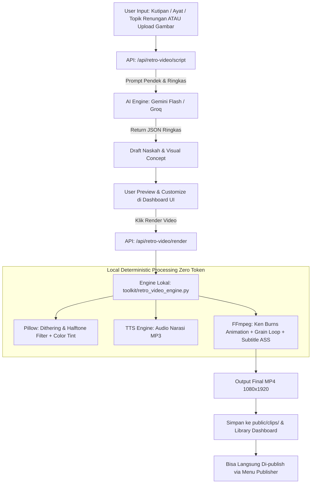

# Plan: Penambahan Menu "Retro Video Studio" (Gaya DzikirQu)
*(Halftone Dithering + Risograph Print + Retro Paper Texture + Motion Subtitle)*

---

## 1. Latar Belakang & Tujuan

Fitur ini bertujuan untuk menambahkan menu baru di dalam aplikasi **Content Trend Intelligence** yang memungkinkan pengguna membuat video berformat vertikal (9:16 untuk Reels, Shorts, TikTok) dengan estetika khas **DzikirQu**:
- **Visual Utama:** Ilustrasi bernuansa *woodcut/vintage engraving* dengan shading bintik *Halftone / Stochastic Dithering*.
- **Warna & Karakter:** Palet *duotone Risograph* (tinta *Charcoal*, *Sepia*, atau *Terracotta*) di atas kanvas kertas tua berserat (*Cream Paper Texture*).
- **Gerakan Video:** Animasi lambat (*Ken Burns slow zoom/pan*), efek kedip tinta (*flicker/grain overlay*), dan debu kertas.
- **Audio & Teks:** Narasi suara kontemplatif (TTS/Voiceover) diiringi musik latar hening (*ambient BGM*) serta subtitle dengan tipografi editorial yang rapi.

---

## 2. Strategi Penghematan Token (Token-Saving Protocol)

Agar konsumsi token AI hemat hingga **>90%** dan proses rendering cepat tanpa biaya API berlebih:

| Komponen | Metode Konvensional (Boros Token/Biaya) | **Metode Rekomendasi (Super Hemat & Lokal)** | Penghematan |
| :--- | :--- | :--- | :--- |
| **Efek Halftone & Paper Texture** | Menggunakan AI Image-to-Image / ComfyUI cloud berkali-kali | **Script Python Lokal (Pillow + NumPy)**: Konversi foto/gambar biasa jadi halftone dither 1-bit secara deterministik. | **100% Free (0 Token)** |
| **Motion & Video Render** | Runway Gen-3 / Pika / Sora (Sangat mahal) | **FFmpeg Filtergraph Lokal**: Pan/Zoom Ken Burns + Paper grain blend overlay. | **100% Free (0 Token)** |
| **Voiceover / Narasi** | ElevenLabs berbayar | **Edge TTS / Piper / Coqui lokal**: Menghasilkan suara natural bahasa Indonesia/Arab tanpa kuota token. | **100% Free** |
| **Ide & Naskah Narasi** | Prompt LLM panjang dan deskriptif tanpa skema | **Strict Minimalist JSON Contract** via Gemini Flash / Groq / Nemotron (hanya minta 3 kalimat hook + narasi + terjemahan). | **Hemat 85% Token LLM** |
| **Asset Caching** | Download tekstur kertas & musik dari internet berulang | **Local Texture & Audio Library** disimpan di `assets/retro/` (Paper background, grain MP4, ambient MP3). | **0 Token & Hemat Bandwidth** |

---

## 3. Arsitektur Sistem & Alur Kerja (Workflow)



---

## 4. Rincian Modul & Perubahan Kode

### A. Penambahan Menu Navigasi
- **File:** `src/components/DashboardLayoutClient.tsx`
- **Tindakan:** Tambahkan item menu di bawah section `"Studio"`:
  ```typescript
  // src/components/DashboardLayoutClient.tsx
  { section: "Studio" },
  { href: "/dashboard/analyzer", label: "Analyzer", icon: Lightbulb },
  { href: "/dashboard/retro-studio", label: "Retro Video Studio", icon: Film }, // <-- MENU BARU
  { href: "/dashboard/library", label: "Library", icon: Library },
  ```

### B. Halaman Antarmuka (UI Page)
- **Path Baru:** `src/app/dashboard/retro-studio/page.tsx`
- **Fitur UI:**
  1. **Input Mode:**
     - *Mode AI Script:* Masukkan topik (contoh: *"Ketenangan Hati saat Cemas"*), AI langsung buatkan naskah 3 kalimat + ayat/hadits.
     - *Mode Manual:* Paste kutipan teks sendiri dan upload gambar ilustrasi pilihan.
  2. **Style Customizer:**
     - Pilihan Tinta Risograph: Charcoal Black, Deep Terracotta, Sage Olive, Vintage Navy.
     - Pilihan Kertas: Unbleached Paper, Kraft Paper, Newsprint, Antique Parchment.
     - Pilihan Kecepatan Zoom (Static / Slow Zoom-in / Subtle Drift).
  3. **Live Canvas Preview:** Preview frame tampilan dengan efek halftone sebelum dirender menjadi video.
  4. **Render & Status Bar:** Progres rendering FFmpeg real-time.

### C. Engine Backend Lokal (`toolkit/retro_video_engine.py`)
Script Python mandiri berkecepatan tinggi:
- **Input:** Gambar dasar, teks subtitle, file audio/narasi, durasi target.
- **Proses:**
  1. `apply_halftone_dither(image_path, ink_color, paper_bg)`
  2. `generate_tts(script_text, voice_id="id-ID-ArdiNeural")`
  3. `build_subtitles_ass(timestamps, font="EB Garamond")`
  4. `ffmpeg_assemble(halftone_img, audio_path, grain_overlay, subtitle_ass, output_mp4)`
- **Output:** File MP4 siap tayang di `public/clips/retro_[timestamp].mp4`.

### D. Skill Agent Khusus
- Telah dibuat di: [`.agents/skills/retro-video-generator/SKILL.md`](file:///home/gli-budi-agf/StudioProjects/tool%20content%20creator/.agents/skills/retro-video-generator/SKILL.md)
- Fungsi: Memandu AI agent dalam mengelola parameter render, format JSON naskah, dan resep FFmpeg tanpa perlu menganalisis dari nol setiap kali instruksi dijalankan.

---

## 5. Rencana Eksekusi Bertahap (Roadmap)

### 📌 Fase 1: Persiapan Asset & Script Engine Python Lokal
- [ ] Buat direktori `assets/retro/textures/` dan `assets/retro/audio/`.
- [ ] Buat script Python `toolkit/retro_video_engine.py` yang memuat logika Pillow Halftone Dithering dan perintah FFmpeg Ken Burns.
- [ ] Lakukan tes render 1 frame dan 1 sampel video 15 detik untuk memverifikasi kualitas visual ala DzikirQu.

### 📌 Fase 2: Pembuatan API Route Next.js
- [ ] Buat `src/app/api/retro-video/script/route.ts` (Generator naskah singkat dengan schema minimalis untuk hemat token).
- [ ] Buat `src/app/api/retro-video/render/route.ts` (Pemanggil proses `retro_video_engine.py`).

### 📌 Fase 3: Pembuatan Halaman Dashboard & Integrasi Sidebar
- [ ] Daftarkan menu `Retro Video Studio` pada [DashboardLayoutClient.tsx](file:///home/gli-budi-agf/StudioProjects/tool%20content%20creator/content-trend-intelligence/src/components/DashboardLayoutClient.tsx).
- [ ] Implementasikan halaman UI di `src/app/dashboard/retro-studio/page.tsx` menggunakan komponen Tailwind & shadcn.

### 📌 Fase 4: Integrasi Publishing & Testing Akhir
- [ ] Hubungkan hasil render video ke menu **Library** dan **Publisher Accounts** (Instagram Reels & TikTok).
- [ ] Pengujian performa, latensi render, dan akurasi estetika.
